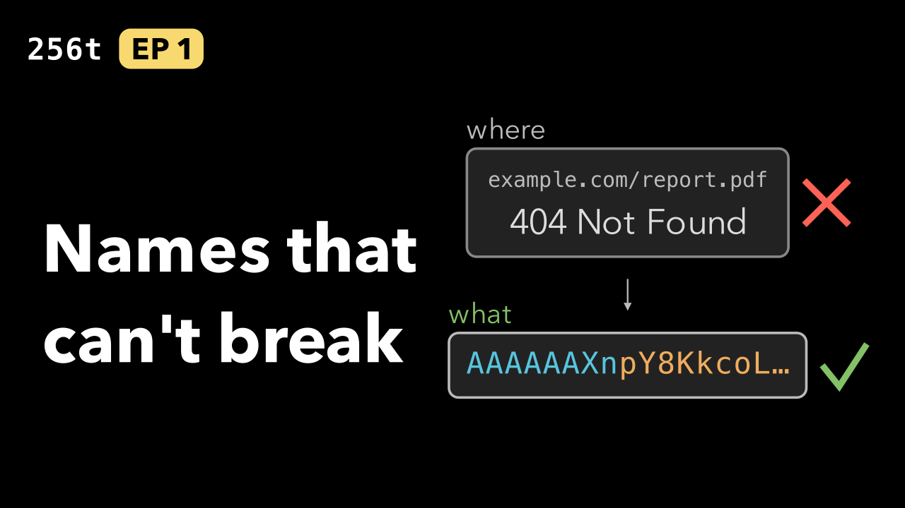
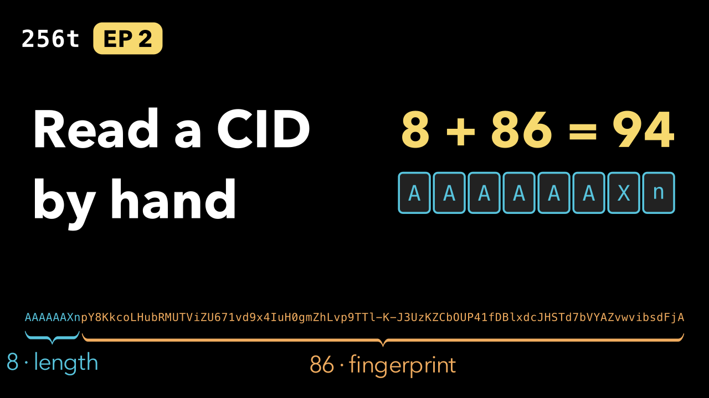
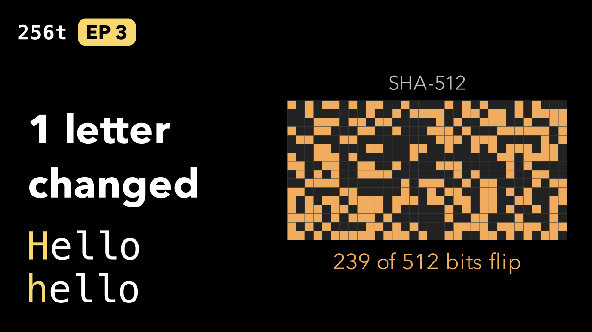
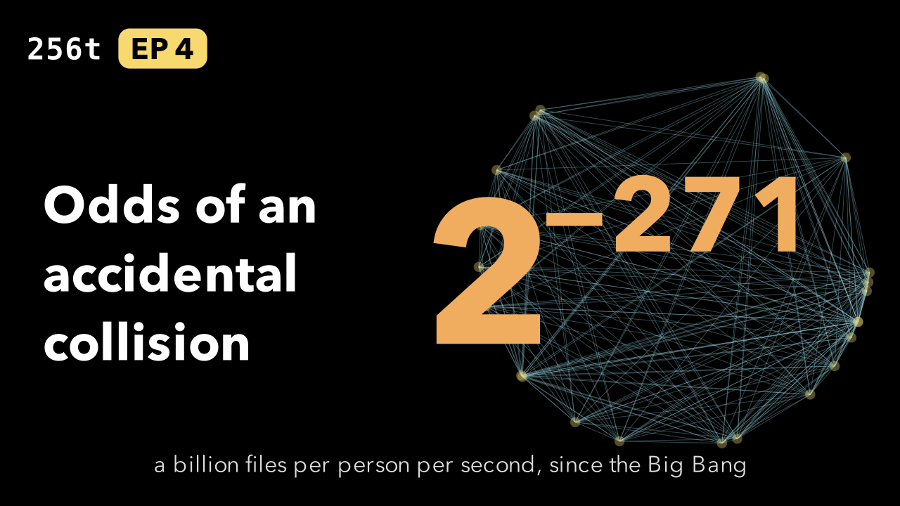
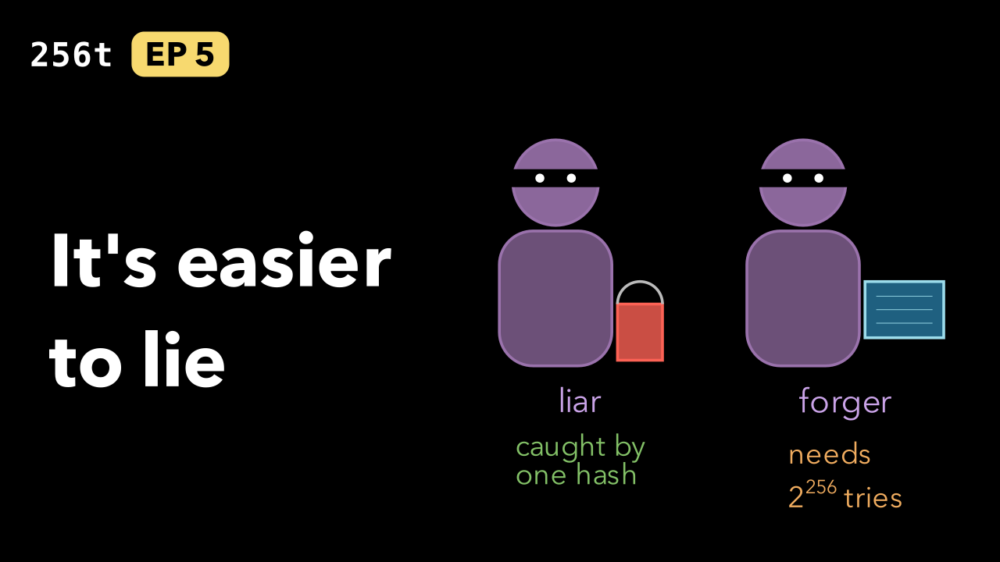
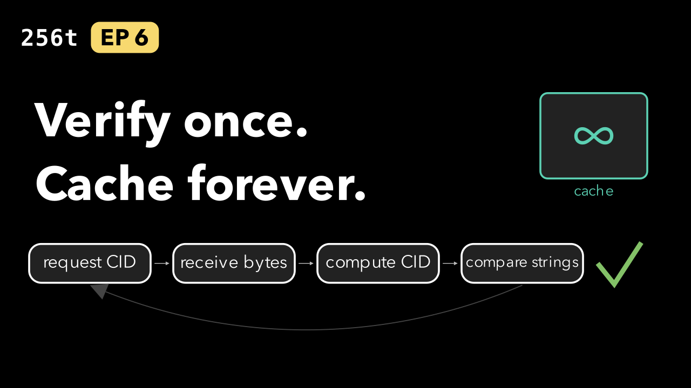
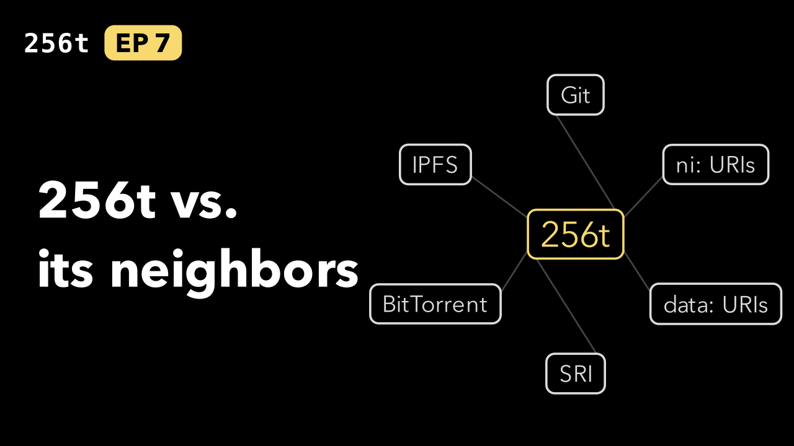

# YouTube upload kit

Everything needed to upload the seven episodes: a title, description, tags and thumbnail per episode,
plus the playlist text. Each `epNN/` folder holds ready-to-paste files.

| # | Thumbnail | Files |
|---|---|---|
| 1 |  | [ep01/](ep01/) |
| 2 |  | [ep02/](ep02/) |
| 3 |  | [ep03/](ep03/) |
| 4 |  | [ep04/](ep04/) |
| 5 |  | [ep05/](ep05/) |
| 6 |  | [ep06/](ep06/) |
| 7 |  | [ep07/](ep07/) |

```
youtube/
  metadata.json       source: titles, hooks, summaries, chapter names, sources, tags
  build.py            writes the files below from metadata.json and the renders
  playlist.txt        playlist title, then its description
  epNN/title.txt
  epNN/description.txt   includes chapter timestamps
  epNN/tags.txt          comma-separated, paste into the Tags field
  epNN/thumbnail.png     1280×720, from manim/thumbnails.py
```

**Edit `metadata.json`, then rebuild.** Don't edit the generated files by hand.

```bash
python3 video-series/youtube/build.py --thumbnails
```

- **Chapters** come from the rendered 1080p scenes: each scene is one chapter, starting where the
  previous scenes end. If you re-render an episode (`manim/render.py N -q h`), rebuild so the timestamps
  still match the uploaded file. `--check` exits non-zero when any generated file is stale.
- **Limits are checked:** titles up to 100 characters, descriptions up to 5,000, tags up to 500 in
  total, no `<` or `>` (YouTube rejects them), chapters at least 10 seconds long, thumbnails under 2 MB.
- **Thumbnails** use the same palette, fonts and visuals as the episodes (`manim/common.py`). Each is a
  still `Scene` in `manim/thumbnails.py`; `--thumbnails` renders them with Manim.

## Upload checklist

For each episode, in order:

1. Upload `video-series/manim/output/epNN.mp4` (rendered at 1080p60, not committed).
2. Paste `title.txt`, `description.txt` and `tags.txt`, and upload `thumbnail.png`.
3. Category **Education**. Audience: not made for kids. Video language: English.
4. **Altered or synthetic content.** The narration is generated with ElevenLabs from the scripts. Decide
   how to answer YouTube's disclosure question under its current policy before publishing.
5. Add an end screen linking to the next episode (and the playlist on the last one).

Then:

6. Create the playlist from `playlist.txt` and add the episodes in order.
7. Add each episode's `"url"` and the series `"playlist_url"` to `metadata.json` and rebuild. The
   descriptions then link to the previous and next episodes and to the playlist; paste the updated
   descriptions into each video.
8. Right before publishing, re-check the time-sensitive claims marked ⏱ in the
   [fact-check table](../README.md#fact-check-table) (the Bitcoin hashrate in Episode 5, and the best
   published SHA-512 attacks).
